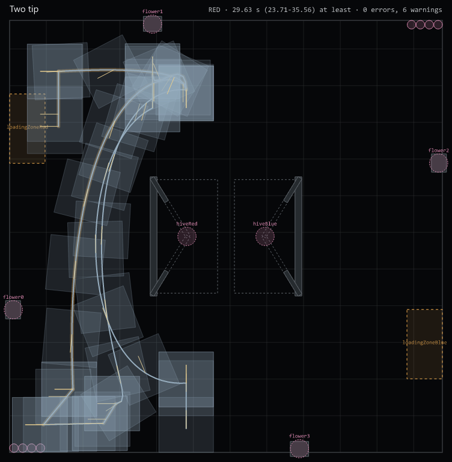
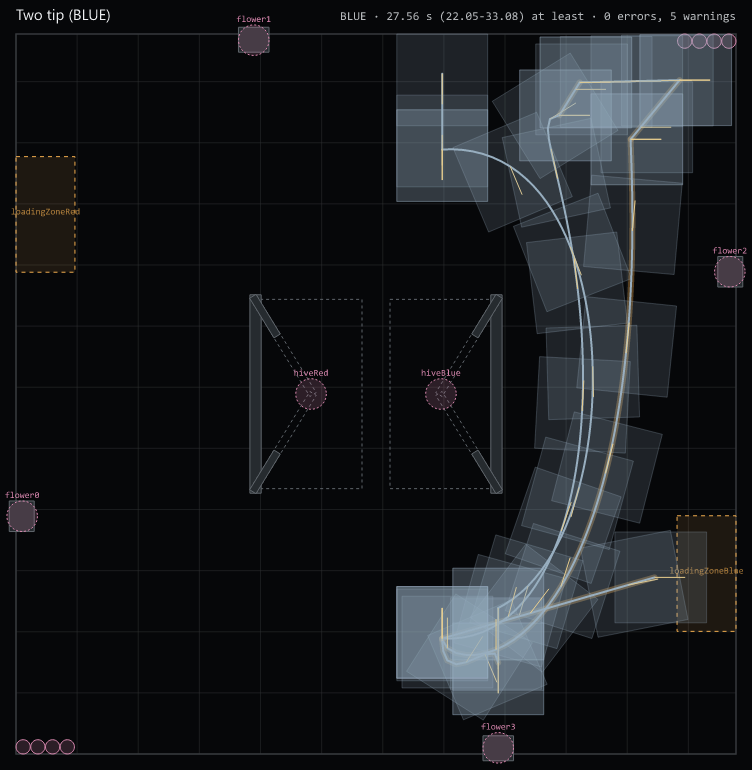

# BioHORS

FTC robot code for the 2026-27 **BIOBUZZ** season, built on the
**PedroPathing Quickstart v3.0.2** (PedroPathing v3, FTC SDK 12.0.0).
Seeded from HORS-Pedro; the MainHORS control scheme carries over, the old
code does not.

Robot: mecanum drive with Pinpoint odometry (2 pods), 2 intake motors,
**2 independent shooters** (pollen and nectar, one goBILDA 5000-series
6000 RPM motor each, same spin direction, different speeds), **2
independent gate servos** (one per shooter). No turret: aiming turns the
whole robot.

The MainHORS teleop with odometry aim, and a Zenith-planned 2-tip pollen auto, both tested in SimLoop.

## OpModes

| OpMode | File | What it does |
|---|---|---|
| MainHORS TeleOp | `teamcode/teleop/MainHorsTeleOp.java` | The teleop: MainHORS controls plus odometry aim (see below) |
| Two tip | `teamcode/zenith/generated/TwoTipAuto.java` (generated) | The 2-tip pollen auto, played from `autos/two-tip.auto.json` by Zenith (see below) |
| Choose Alliance | `teamcode/opmodes/ChooseAlliance.java` | Run before the auto: dpad left = RED, dpad right = BLUE |
| Shooter Tuner | `teamcode/tuning/ShooterTuner.java` | Measures each shooter's feedforward (power sweep) and P (search), prints PIDF to paste into `MechanismConstants`. Robot on blocks, no pollen |
| Tuning (Quickstart) | `teamcode/pedro/Tuning.java` + `procedures/` | PedroPathing tuners, including the Pinpoint Tuner |

## Hardware map (must match the Robot Controller config exactly)

| Name | Device | Notes |
|---|---|---|
| frontLeft, backLeft | DcMotor | Drive, FORWARD |
| frontRight, backRight | DcMotor | Drive, REVERSE |
| intakeLeft, intakeRight | DcMotor | Intakes, run together |
| shooterRight | DcMotorEx | **Pollen** shooter (confirmed: right side, top-down with the intake up) |
| shooterLeft | DcMotorEx | **Nectar** shooter (confirmed: left side) |
| gateRight | Servo | **Pollen** gate (confirmed) |
| gateLeft | Servo | **Nectar** gate (confirmed) |
| pinpoint | GoBildaPinpointDriver | Pinpoint odometry computer (2 pods), used by the Pedro localizer |

Shooter/gate names, directions, and tuning values live in
`teamcode/subsystems/MechanismConstants.java`.

## Teleop controls (MainHORS TeleOp; gamepad2 mirrors the mechanism buttons)

| Control | Action |
|---|---|
| Left stick | Drive (forward / strafe) |
| Right stick X | Turn (overridden while aiming) |
| Left trigger (hold) | **Aim**: turn the robot to face our hive's cell on this half of the field |
| Right bumper (hold) | Slow mode, 0.45x |
| Right trigger | Intake in |
| Y (hold) | Outtake |
| Dpad down | Toggle both shooters on/off, each at its own target (start OFF) |
| Dpad left / right | **Pollen** shooter target RPM − / + (its own step, 50 rpm) |
| X / A | **Nectar** shooter target RPM − / + (its own step, 50 rpm) |
| B | Toggle both gates (start CLOSED) |
| Left bumper | Unmapped |

Before PLAY, pick the alliance: dpad left = RED, dpad right = BLUE. If an auto ran first, its
alliance and final pose are picked up automatically (the SDK blackboard).

**Aim.** No camera and no turret: holding the left trigger turns the whole chassis to face the
hive cell on the robot's half of the field (north cell when y > 0, south when y < 0, with 2 in of
hysteresis at the line), from the Pinpoint pose and the hive's fixed field coordinates (BIOBUZZ
field file: RED hive pivot (-12.75, 0), BLUE (+12.75, 0), cell centres 9.264 in either side along
y). A launch only scores from the up cell's own quarter, so the driver picks the cell by where
they drive; there is no goal toggle.
The driver keeps forward/strafe; yaw gets priority over translation, and a feedforward on the
bearing rate keeps the aim on target while strafing. If the Pinpoint is not READY or the pose is not a number, aim falls
back to manual turn and telemetry shows `POSE INVALID`. Telemetry always shows the alliance,
target cell, aiming on/off, heading error and pose.

## The 2-tip auto (Zenith)

`autos/two-tip.auto.json`, planned with [Zenith](https://zenith.horizon36596.org) and played on the
robot by Zenith's runtime through the Pedro v3 follower and the named commands in
`zenith/BioHorsCommands.java`. Pollen only, 12 pollen in 3 volleys of 4 (RED described):

1. Score the 4 preload from `scoreSouth` into the up cell, on the 3 staged nectar: **tip 1**.
2. Go round the west of the hive frame to flower1 (north wall), take its 4 with the flower bar down,
   score them from `scoreNorth`.
3. Sweep the RED garden row along the south wall (bar stowed), drive back and score from
   `scoreNorth`: **tip 2**. Park.

 

**One OpMode per alliance: pick the one for your side.** "Two tip" runs `autos/two-tip.auto.json`
(RED); "Two tip (BLUE)" runs `autos/two-tip-blue.auto.json`, Zenith's mirror of the RED file
(BIOBUZZ is point-symmetric), written by `node tools/mirror_auto.mjs`. The Zenith autos ignore
**Choose Alliance** (it is still used by the state-machine auto and by the teleop when no auto ran).
When the auto stops, its alliance and pose go to the teleop's aim. After any change to the RED auto
or `autos/waypoints.json`, re-run `node tools/mirror_auto.mjs`, then `npx zenith deploy` and
`npx zenith codegen two-tip-blue`; `BlueAutoMirrorTest` fails until you do.

Editing it: `npm install` (pins the Zenith CLI and MCP in `package.json`), then use the Zenith MCP
server (`.mcp.json`) or `npx zenith validate|estimate|render|deploy|sim ... --json`. The
`build-auto` skill (`.claude/skills/build-auto/`, with `references/robot.md` for this robot) is the
workflow. Never edit `TeamCode/src/main/assets/autos/` or `zenith/generated/`: `npx zenith deploy`
writes them. No mid-path markers: Zenith v0.1.2's marker runner needs a Pedro method Pedro 3.0.2 lacks.

## Simulation (SimLoop)

`./gradlew :TeamCode:testDebugUnitTest` (Windows: `.\gradlew.bat ...`) runs the real OpModes on a
laptop against fake hardware, in `TeamCode/src/test/java/org/firstinspires/ftc/teamcode/sim/`:

- `BioHorsSim`: this robot's fake devices and physics (drive, Pinpoint, shooters, gates, intake).
- `MainHorsTeleOpSimTest`: the teleop (drive, slow mode, aim, goal switch, aim while strafing,
  Pinpoint-fault fallback, BLUE, shooters, gates, intake, determinism).
- `ZenithAutoMatchTest` + `BiobuzzMatch` + `TracedZenithAuto`: the deployed auto as a BIOBUZZ match,
  stopped at 30 s like the field: RED twice (identical logs) and BLUE once. It checks 16 pollen and
  2 tips in AUTO, every step in order, no structure contact, strafing under 20 % of the driving,
  and the robot's belief against the sim's truth. `npx zenith sim two-tip` runs the same test.

Every sim number is a placeholder until measured (`docs/TUNING.md`), so the sim proves the code's
logic and wiring, not the real robot's timing.

RLOGs and Zenith traces land in `TeamCode/build/sim/` (gitignored; re-run the tests to regenerate).

**Watch a run on the 3D field.** Open `TeamCode/build/sim/two-tip-red.rlog` (or `two-tip-blue.rlog`,
`teleop-aim.rlog`) in [AdvantageScope](https://docs.advantagescope.org/), open a **3D Field** tab
(or 2D Field) and pick **2026-2027 Field**. From `RealOutputs/Field`, drag:

- `Robot` onto the field: the robot's true pose (choose a robot model, e.g. FTC drive base);
- `RobotBelief` and set it to **Ghost**: where the robot thinks it is (match runs);
- `Pollen` and set it to **Game Piece → Pollen**: the garden line, the flower columns, the 4
  aboard, each launch flying into the hive, the pollen in the cells, and each tip's spill.

Press play. Poses are logged in AdvantageScope's FTC "Center/Rotated" frame (metres), converted
from the field frame the code uses by `sim/AdvantageScopeFrame`. `Match/scored`, `Match/tips`,
`Shooter/pollenRpm` plot on a Line Graph.

## Nothing is tuned yet

The full brief, item by item, is [`docs/TUNING.md`](docs/TUNING.md).

Every tuning number in the code carries a provenance label: `SPEC` (from a
spec sheet), `PLACEHOLDER` (made up so the code runs), or
`NEEDS MEASUREMENT`. None are measured. Do not treat any as real.

1. **Shooters** (`subsystems/MechanismConstants.java`): each shooter has
   its own target RPM, PIDF, tolerance, and feedforward. Gains are
   placeholders. `ticksPerRev` = 28 and feedforward max = 2800 ticks/sec
   are the goBILDA 6000 RPM motor spec. `ticksPerRev` counts per flywheel
   revolution, so 28 only holds if the flywheel is direct-driven (1:1);
   with a belt/gear ratio, multiply it by the ratio. The 2800 ticks/sec is
   the motor encoder's free speed and does not change with the ratio.
   Shooter motor directions and which motor is pollen still need
   verifying on the robot.
2. **Gates** (`subsystems/MechanismConstants.java`): open/closed position
   per gate. Both start at the old shared placeholders (0.67 / 0.485).
3. **Pinpoint** (`pedro/Constants.java`): pod offsets and directions. Run
   the Quickstart's Pinpoint Tuner on the robot.
4. **Aim** (`aim/AimController.java`): kP, yaw cap, minimum yaw, on-target
   tolerance, turn rate at full yaw, and which way the shooter fires
   (`SHOOTER_FACING_OFFSET_RAD`). Teleop default start pose
   (`teleop/MainHorsTeleOp.java`) when no auto ran first.
5. **Drive shaping, intake power, Foresight gains, auto timing**: placeholders, labelled in
   their files.

## Building

Open in Android Studio (Narwhal 3 Feature Drop or later) and build like any
FTC SDK project. The PedroPathing dependencies (revhub 3.0.2, tuning 1.0.1)
are in `build.dependencies.gradle`.

## Horizon's tools

Zenith (beta) and SimLoop (alpha) are by Horizon (FTC 36596) and are early; they are looking for
testers and contributors. Zenith: <https://zenith.horizon36596.org> · SimLoop:
<https://github.com/Horizon-36596/simloop> · Example robot:
<https://github.com/Horizon-36596/Horizon-Library-Examples> · Docs: <https://libraries.horizon36596.org> ·
Discord: <https://discord.gg/p2D3JpM4f6> · Release video: <https://youtu.be/NFww9Mt-ZR4>

## Workflow

Work on branches and open PRs; Greptile reviews every PR. Do not push to
`main` directly.
